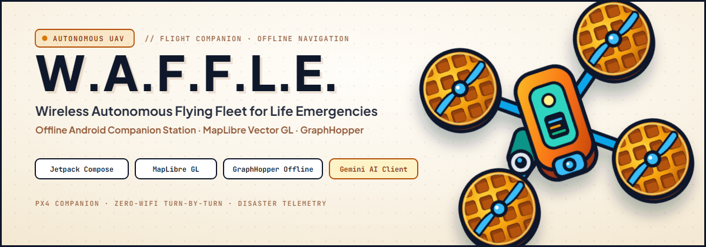

<p align="center">
  
</p>

<h1 align="center">W.A.F.F.L.E. Maps</h1>

<p align="center">
  <strong>The offline vector map stack behind Project W.A.F.F.L.E. — Pakistan basemap, 809,824 places, bilingual labels, offline search, navigation‑ready.</strong>
</p>

<p align="center">
  
  
  
  
  
  
</p>

> **Part of [Project W.A.F.F.L.E.](https://github.com/AhmadHasssan9181/Waffle)** — the offline field console.
> This repository contains the map data, styles, packaging and search index the console consumes.

---

##  &nbsp;What this is

A **fully offline, MapLibre‑native vector map of Pakistan**, built to replace label‑less local
map packs and feed GraphHopper offline routing:

- **Basemap** — OpenMapTiles schema, z0–14, 253,618 tiles, 266 MB.
- **Places** — 809,824 named POIs (Overture Maps), z11–14, with phone / website / address / status.
- **Search** — SQLite FTS5 index of all 809,824 names, prefix + ranked, fully offline.
- **Styles** — light / dark / field × English / Urdu / both, 47 layers each.
- **Assets** — sprite + all 256 glyph ranges for Noto Sans (regular/medium/italic).

---

##  &nbsp;Screenshots

<table>
  <tr>
    <td align="center" width="50%">
      
      <br /><sub><b>Light</b> — Google‑style highways, POI icons, street &amp; district labels</sub>
    </td>
    <td align="center" width="50%">
      
      <br /><sub><b>Dark</b> — night navigation</sub>
    </td>
  </tr>
  <tr>
    <td align="center" width="50%">
      
      <br /><sub><b>Field</b> — black + amber high‑contrast for sunlight/low light</sub>
    </td>
    <td align="center" width="50%">
      
      <br /><sub><b>Navigation</b> — 3D pitch, route casing/arrows, HUD, speed limit</sub>
    </td>
  </tr>
</table>

---

##  &nbsp;Download the data

The three large artifacts live in the **[latest release](https://github.com/AhmadHasssan9181/waffle-maps/releases/latest)**
(GitHub blocks >100 MB files from a normal repo).

| File | Size | Contents |
|---|---:|---|
| `pakistan_vector.pmtiles` | 266 MB | Basemap, z0–14, MVT/gzip, OpenMapTiles schema |
| `pakistan_places.pmtiles` | 214.5 MB | 809,824 places, z11–14, layer `place` |
| `places_search.db` | 104.4 MB | SQLite FTS5 index (`places`, `places_fts`) |

Put them in `data/` (see [`data/README.md`](./data/README.md)).

---

##  &nbsp;Repository layout

```
styles/       9 app-ready styles (light/dark/field × EN/UR/both)
app-assets/   sprite + all 256 glyph ranges (Android assets)
web/          self-contained preview: viewers, styles, assets, libs
scripts/      the full data pipeline
data/         download the release assets here (README)
assets/       brand + screenshots
```

---

##  &nbsp;Quick start

### Android (MapLibre Native)

1. Download the release files into your app's external files dir.
2. Copy `app-assets/` into the app assets (`assets/sprite`, `assets/fonts`).
3. Use a `pmtiles://file://…` source for both archives:
   ```json
   "v":      { "type": "vector", "url": "pmtiles://…/pakistan_vector.pmtiles" },
   "places": { "type": "vector", "url": "pmtiles://…/pakistan_places.pmtiles" }
   ```
4. Load one of `styles/style_*.json`. See [`HANDOFF.md`](./HANDOFF.md) for the full wiring guide.

### Web preview

```bash
cd data
python -m http.server 8001
# in another shell, from the repo root:
python scripts/serve_proxy.py 8083
python scripts/serve_search.py 8084
python scripts/serve_range.py 8082
../tools/pmtiles serve . --port 8080
# open http://localhost:8001/... (copy web/ into data/ or serve both)
```

Or serve the repo root and open `web/themed_viewer.html` (adjust the `data/` paths).

---

##  &nbsp;How it is built

| Stage | Script | Notes |
|---|---|---|
| Basemap | `make_water_polygons.py` → `planetiler` | OSM PBF → PMTiles, z0–14, OpenMapTiles |
| Places | `build_overture_pois.py` | Overture → DuckDB `ST_AsMVT` → PMTiles |
| Search | `build_search_index.py` | DuckDB → SQLite FTS5 |
| Styles | `make_styles_pretty.py` + `add_places_layer.py` + `make_urdu_styles.py` | 9 variants |
| Assets | `fetch_fonts.py` | all 256 glyph ranges |
| Bundle | `package_android.py` | `android-assets/` |

---

##  &nbsp;Notes &amp; gotchas

- **Bundle all glyph ranges.** A missing range makes that tile's symbol bucket fail and the
  whole tile disappears.
- **maxzoom 14 + overzoom.** MapLibre renders z15+ by overzooming; do not request z15+ tiles
  from a server.
- **Google raster tiles are pictures**, not data — amenities come from OSM + Overture.
- **Ocean** is from Natural Earth 10m (the canonical OSM water host was unreachable) — slightly
  coarse.
- **Urdu** uses `name:ur`; the bundled Noto Sans already contains the Arabic/Urdu glyphs.

---

##  &nbsp;Attribution

- Map data © **OpenStreetMap contributors** — ODbL 1.0
- Tiles produced with **OpenMapTiles** — CC‑BY
- Places © **Overture Maps Foundation** — CDLA‑Permissive 2.0
- Fonts: **Noto Sans** — SIL OFL
- Rendering: **MapLibre** (BSD)

See [`ATTRIBUTIONS.md`](./ATTRIBUTIONS.md).

---

<p align="center">
  <a href="https://github.com/AhmadHasssan9181/Waffle">
    
  </a>
</p>
