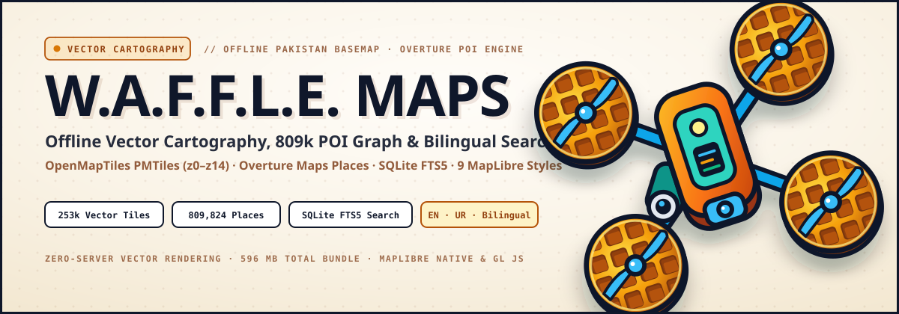
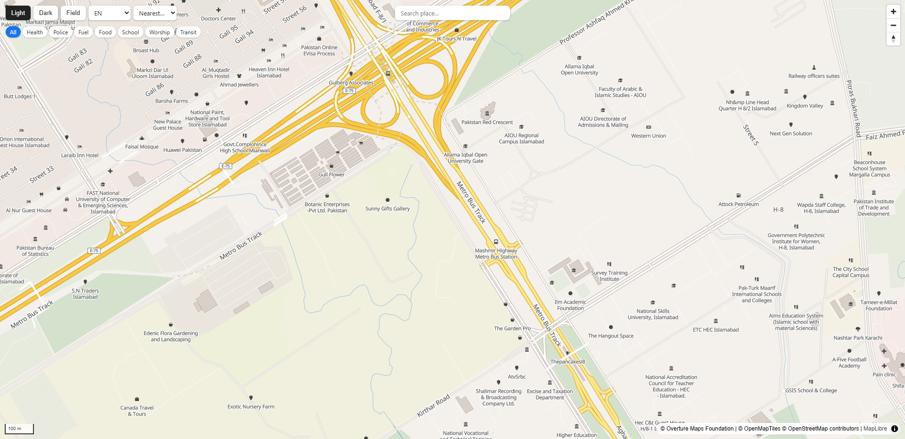
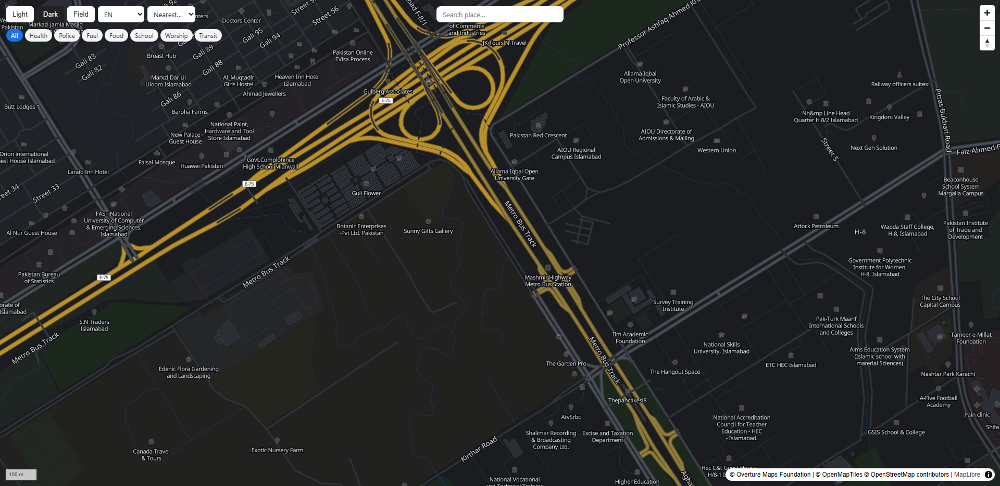
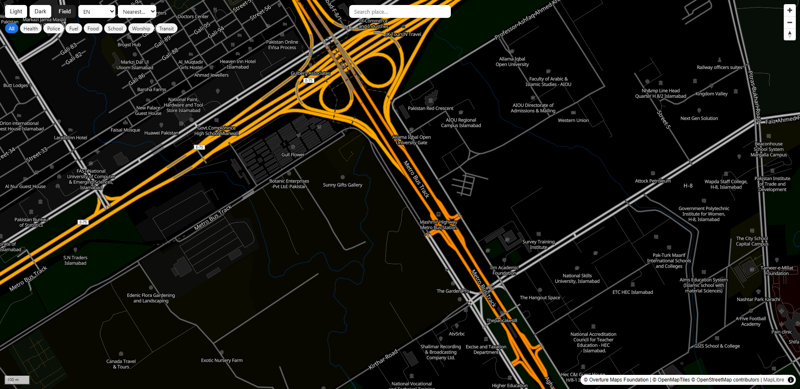
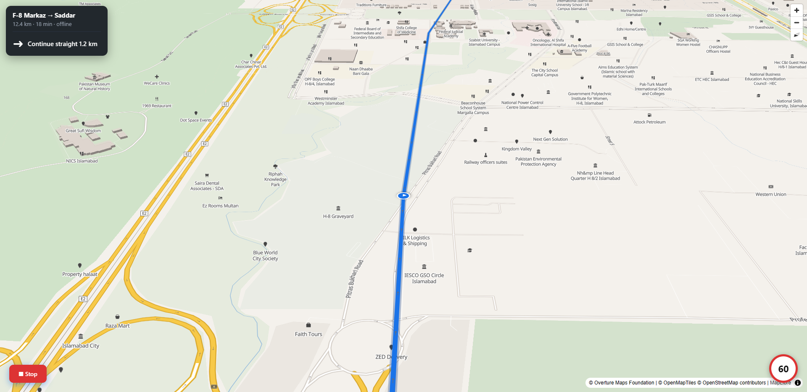
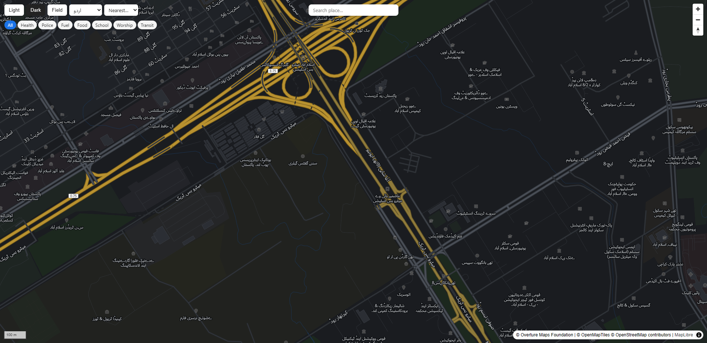
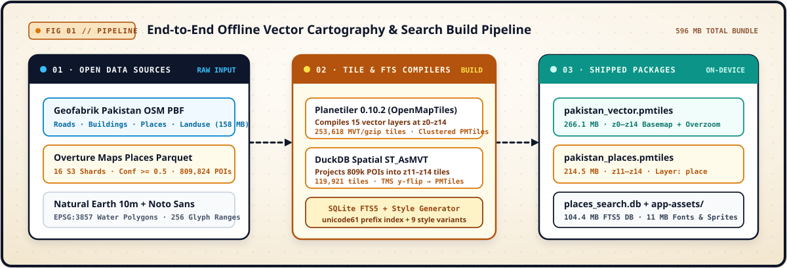
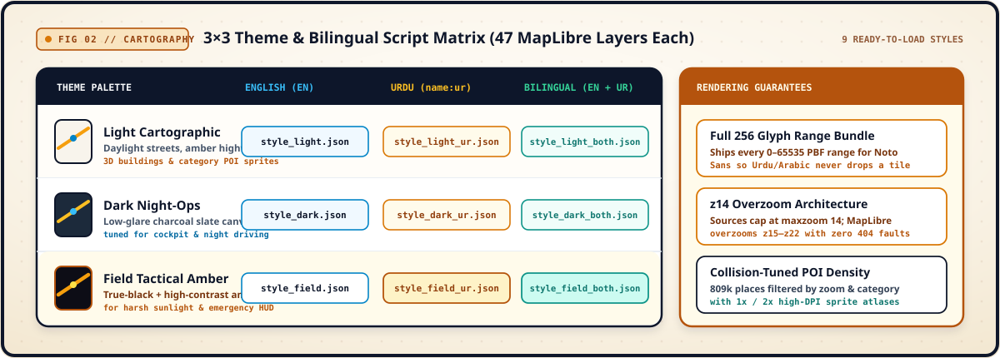
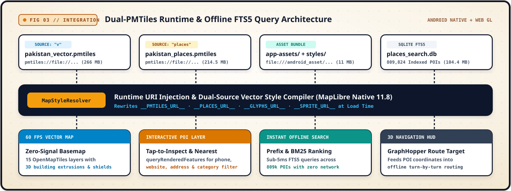

<p align="center">
  
</p>

<h1 align="center">W.A.F.F.L.E. Maps — Offline Vector Cartography &amp; POI Stack</h1>

<p align="center">
  <strong>Self-contained Pakistan vector basemap, 809,824 Overture POIs, bilingual English/Urdu MapLibre styles, and SQLite FTS5 search built for zero-connectivity field operations.</strong>
</p>

<p align="center">
  <a href="https://github.com/AhmadHasssan9181/waffle-maps/releases/tag/v1.0.0">
    
  </a>
  &nbsp;
  <a href="https://github.com/AhmadHasssan9181/Waffle">
    
  </a>
  &nbsp;
  <a href="https://github.com/AhmadHasssan9181/waffle-maps/issues">
    
  </a>
</p>

<p align="center">
  
  
  
  
  
  
</p>

> [!IMPORTANT]
> **Core Cartographic Subsystem for [Project W.A.F.F.L.E.](https://github.com/AhmadHasssan9181/Waffle).** This repository houses the offline vector tile generation pipeline, 9 bilingual MapLibre style definitions, full 256-range Noto Sans glyph packs, high-DPI sprite atlases, and the standalone WebGL inspection suite consumed by the W.A.F.F.L.E. Android ground console. Large binary archives (`*.pmtiles`, `places_search.db`) are distributed via [**GitHub Releases (`v1.0.0`)**](https://github.com/AhmadHasssan9181/waffle-maps/releases/tag/v1.0.0).

---

##  &nbsp;Theme &amp; Navigation Previews

**W.A.F.F.L.E. Maps** delivers 60 FPS vector rendering across three field-tuned color palettes (**Light**, **Dark**, and **Field Tactical**) plus a 3D turn-by-turn navigation camera with route casing, directional chevrons, and live POI inspection—operating with **zero network requests**.

<table>
  <tr>
    <td align="center" width="50%">
      
      <br /><br />
      <b>Light Cartographic Theme</b>
      <br />
      <sub>Daylight arterial hierarchy, 3D building extrusions, category POI sprites, and bilingual district labels</sub>
    </td>
    <td align="center" width="50%">
      
      <br /><br />
      <b>Dark Night-Ops Theme</b>
      <br />
      <sub>Low-glare slate surface engineered for night driving, cockpit operation, and reduced eye strain</sub>
    </td>
  </tr>
  <tr>
    <td align="center" width="50%">
      
      <br /><br />
      <b>Field Tactical Amber Theme</b>
      <br />
      <sub>True-black canvas paired with high-luminance amber highways for direct sunlight and emergency HUDs</sub>
    </td>
    <td align="center" width="50%">
      
      <br /><br />
      <b>3D Turn-by-Turn Navigation HUD</b>
      <br />
      <sub>Pitched camera, dual-layer route casing with directional arrows, maneuver banner, and speed-limit badge</sub>
    </td>
  </tr>
  <tr>
    <td align="center" colspan="2" width="100%">
      
      <br /><br />
      <b>Urdu (اردو) — Properly Shaped Right-to-Left Labels</b>
      <br />
      <sub>ICU Arabic joining + Unicode bidi via the bundled RTL text plugin; <code>name:ur</code> labels render with connected letterforms and correct right-to-left order</sub>
    </td>
  </tr>
</table>

---

##  &nbsp;End-to-End Cartographic Build Pipeline

Raw open geospatial datasets are compiled into single-file, random-access `PMTiles` archives and an indexed `SQLite FTS5` database so the entire national map stack mounts directly from flash storage without a tile server.

<p align="center">
  
</p>

<table>
  <tr>
    <td width="33%" valign="top">
      <b>OpenMapTiles Vector Basemap</b>
      <br />
      <sub>Compiled via <b>Planetiler 0.10.2</b> from Geofabrik Pakistan OSM PBF + EPSG:3857 water polygons into <b>253,618 MVT/gzip tiles</b> across 15 schema layers (<code>z0–z14</code>).</sub>
    </td>
    <td width="33%" valign="top">
      <b>809,824 Overture Maps POIs</b>
      <br />
      <sub>Extracted from 16 Overture Parquet shards via <b>DuckDB Spatial</b> (<code>ST_AsMVT</code>) with confidence <code>&ge; 0.5</code>, preserving category, phone, website, address, and operating status.</sub>
    </td>
    <td width="33%" valign="top">
      <b>Sub-5ms Offline FTS5 Search</b>
      <br />
      <sub>Indexes all <b>809,824 named places</b> using SQLite <code>FTS5</code> (<code>unicode61 remove_diacritics 2</code>) for instant prefix autocomplete and BM25-ranked coordinate lookup.</sub>
    </td>
  </tr>
</table>

---

##  &nbsp;3×3 Theme &amp; Bilingual Script Matrix

Every visual theme is compiled in three script variants—**English (`name:en`)**, **Urdu (`name:ur`)**, and **Bilingual (`EN + UR`)**—yielding **9 production MapLibre style JSONs** (`47 layers` each) backed by all 256 Unicode PBF glyph ranges (`0–65535`).

> [!NOTE]
> **Urdu is shaped, not just substituted.** The web suite bundles `mapbox-gl-rtl-text` (ICU Arabic joining + Unicode bidi) and a `maplibre-gl.js` build that waits for the plugin's asynchronous WASM registration before laying out text. `name:ur` labels therefore render with proper joined letterforms and right-to-left order. MapLibre Native applies the same shaping natively on Android, so no plugin is required there.
>
> **Coverage is filled, not left blank.** OSM tags `name:ur` on only ~31% of named roads and ~12% of named places. A build-time transliteration pass (`transliterate_words.py` + `urdu_patch.py`) converts the remaining Latin names into Urdu script using a cached word dictionary and deterministic rules, then writes `name:ur` directly into **both PMTiles**. The Urdu styles are therefore fully Urdu and remain 100% offline at runtime.

<p align="center">
  
</p>

---

##  &nbsp;Dual-PMTiles Runtime &amp; Query Architecture

At runtime, `MapStyleResolver` rewrites the four template tokens (`__PMTILES_URL__`, `__PLACES_URL__`, `__GLYPHS_URL__`, `__SPRITE_URL__`) to bind local `pmtiles://file://` and `file:///android_asset/` URIs—eliminating remote style timeouts, `HTTP 429` quota failures, and missing-glyph tile drops.

<p align="center">
  
</p>

---

##  &nbsp;Release Artifacts &amp; Verification

<p align="center">
  <a href="https://github.com/AhmadHasssan9181/waffle-maps/releases/tag/v1.0.0">
    
  </a>
</p>

Because GitHub restricts repository blobs above `100 MB`, the three compiled binary archives are published in the [**`v1.0.0` Release**](https://github.com/AhmadHasssan9181/waffle-maps/releases/tag/v1.0.0). Download them into [`data/`](./data/README.md) for local web inspection or into your Android device's external files directory:

| Artifact | Size | Zoom / Scope | Schema &amp; Contents |
| :--- | ---: | :---: | :--- |
| **`pakistan_vector.pmtiles`** | `276.9 MB` | `z0 – z14` | **253,618 MVT/gzip tiles** · OpenMapTiles 15-layer national basemap (`60.8°E–77.2°E, 23.3°N–37.1°N`) · full **`name:ur`** coverage via build-time transliteration |
| **`pakistan_places.pmtiles`** | `274.7 MB` | `z11 – z14` | **119,921 MVT/gzip tiles** · **809,824 Overture POIs** in layer `place` (`name`, `name:ur`, `cat`, `bcat`, `phone`, `website`, `addr`, `status`) |
| **`places_search.db`** | `153.5 MB` | National | **SQLite FTS5** full-text index (`places` + `places_fts`) over `name` + `name_ur`, with prefix &amp; BM25 ranking |
| **`app-assets/` + `styles/`** | `~11.0 MB` | All Zooms | **9 style variants** + `1x`/`2x` sprite sheets + **all 256 PBF glyph ranges** per Noto Sans weight (tracked in git) |

Verify archive integrity after downloading:

```bash
pmtiles verify data/pakistan_vector.pmtiles
pmtiles verify data/pakistan_places.pmtiles
sqlite3 data/places_search.db "SELECT count(*) FROM places;"   # -> 809824
```

---

##  &nbsp;Repository Layout &amp; Quick Start

```text
waffle-maps/
├── styles/                 # 9 parameterized Android/MapLibre styles (light/dark/field × EN/UR/both)
├── app-assets/             # Ready-to-bundle Android assets
│   ├── fonts/              # Noto Sans Regular, Medium & Italic (256 PBF ranges each: 0-255..65280-65535)
│   └── sprite/             # 1x and @2x POI & highway shield sprite sheets
├── web/                    # Self-contained MapLibre GL JS inspection suite
│   ├── themed_viewer.html  # Theme, script (EN/UR/Both), category filter & nearest-POI inspector
│   ├── nav_viewer.html     # 3D turn-by-turn navigation HUD & route casing simulator
│   ├── offline_viewer.html # Minimal single-file local viewer
│   ├── assets/             # MapLibre GL, PMTiles, RTL text plugin, sprite & glyph ranges
│   └── style_*.json        # Local-server style definitions (EN / UR / bilingual)
├── scripts/                # Reproducible data & cartography build pipeline
│   ├── make_water_polygons.py
│   ├── build_overture_pois.py
│   ├── build_search_index.py
│   ├── make_styles_pretty.py
│   ├── add_places_layer.py
│   ├── make_urdu_styles.py
│   ├── transliterate_words.py  # Build-time Latin → Urdu dictionary (cached)
│   ├── urdu_patch.py           # Fill name:ur in both PMTiles
│   ├── urdu_search.py          # Add name_ur + bilingual FTS5 index
│   ├── package_android.py
│   └── serve_*.py          # Static CORS, HTTP Range, proxy & FTS5 search microservices
├── data/                   # Drop release binaries here (pakistan_vector.pmtiles, pakistan_places.pmtiles, places_search.db)
└── ATTRIBUTIONS.md         # Third-party data & software attributions
```

### 1. Android Integration (MapLibre Native `11.8+`)

1. Copy `app-assets/fonts` and `app-assets/sprite` into your Android module's `src/main/assets/`, and copy `styles/style_*.json` into `src/main/assets/vector_styles/`.
2. Place `pakistan_vector.pmtiles`, `pakistan_places.pmtiles`, and `places_search.db` in the app's external files directory (`context.getExternalFilesDir(null)`).
3. Resolve the template placeholders at runtime before passing the JSON string to `Style.Builder().fromJson(...)`:

```kotlin
val rawStyle = context.assets.open("vector_styles/style_field_both.json")
    .bufferedReader().use { it.readText() }

val resolvedStyle = rawStyle
    .replace("__PMTILES_URL__", "pmtiles://file://${vectorFile.absolutePath}")
    .replace("__PLACES_URL__",  "pmtiles://file://${placesFile.absolutePath}")
    .replace("__GLYPHS_URL__",  "asset://fonts/{fontstack}/{range}.pbf")
    .replace("__SPRITE_URL__",  "asset://sprite/sprite")
```

4. Query rendered POIs on tap via `map.queryRenderedFeatures(screenPoint, "places")` and run prefix lookups against `places_search.db`:

```sql
SELECT p.name, p.cat, p.bcat, p.lon, p.lat
FROM places_fts f
JOIN places p ON p.id = f.rowid
WHERE places_fts MATCH 'pims*'
ORDER BY bm25(places_fts)
LIMIT 20;
```

### 2. Local WebGL Preview Suite

After placing the three release files in `data/`, launch the local static, tile, search, and proxy services from the repository root:

```bash
# 0. Serve the web suite with CORS (MapLibre's worker needs it to load the RTL plugin)
python scripts/serve_web.py 8001 web

# 1. Serve PMTiles / HTTP Range archives + FTS5 search API
python scripts/serve_range.py 8082
python scripts/serve_search.py 8084
python scripts/serve_proxy.py 8083

# 2. Open the interactive viewers
# - http://localhost:8001/themed_viewer.html  (theme, language & POI explorer)
# - http://localhost:8001/nav_viewer.html     (3D turn-by-turn simulator)
```

---

##  &nbsp;Attribution &amp; Licensing

All cartographic schemas, style generators, and integration scripts in this repository are released for **personal, non-commercial use** alongside [Project W.A.F.F.L.E.](https://github.com/AhmadHasssan9181/Waffle). Map data and fonts are governed by their respective open licenses:

- **Basemap Data:** © [OpenStreetMap contributors](https://www.openstreetmap.org/copyright) — licensed under **ODbL 1.0**
- **Vector Tile Schema:** © [OpenMapTiles](https://openmaptiles.org/) — licensed under **CC-BY 4.0**
- **Places Dataset:** © [Overture Maps Foundation](https://overturemaps.org/) (`2026-10-21.0`) — licensed under **CDLA-Permissive 2.0**
- **Water Polygons:** [Natural Earth 10m](https://www.naturalearthdata.com/) — **Public Domain**
- **Typography, Engine &amp; RTL:** **Noto Sans** (**SIL OFL 1.1**) · **MapLibre GL** (**BSD 3-Clause**) · **PMTiles** (**BSD 3-Clause**) · **Mapbox RTL Text Plugin** (**BSD-2-Clause**)

Full third-party notices and required credit strings are documented in [**`ATTRIBUTIONS.md`**](./ATTRIBUTIONS.md).

---

<p align="center">
  
  <br />
  <sub>
    Crafted by <a href="https://github.com/AhmadHasssan9181"><b>Ahmad Hassan</b></a> &nbsp;·&nbsp;
    <a href="https://github.com/AhmadHasssan9181/Waffle">Project W.A.F.F.L.E.</a> &nbsp;·&nbsp;
    <a href="https://github.com/AhmadHasssan9181/waffle-maps/releases">Releases</a> &nbsp;·&nbsp;
    <a href="https://github.com/AhmadHasssan9181/waffle-maps/issues">Issue Tracker</a>
  </sub>
</p>
